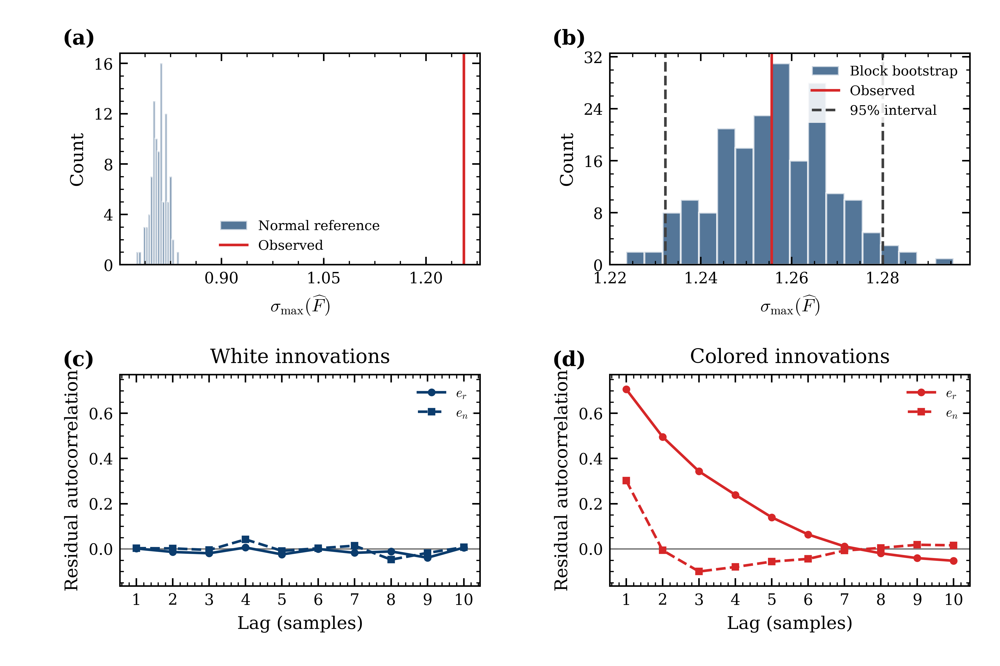

<p align="center">
  <picture>
    <source media="(prefers-color-scheme: dark)"
            srcset="docs/assets/NNDR_logo_dark.png">
    <source media="(prefers-color-scheme: light)"
            srcset="docs/assets/NNDR_logo_light.png">
    
  </picture>
</p>

# NNDR: Non-Normal Directional Response inference

**Discover how perturbations amplify in stable dynamical systems.**

V. R. Saiprasad, V. Troude, D. Sornette

[](https://github.com/Saiprasad-V-R/nndr-toolkit/releases/tag/2.0.0) [](https://www.python.org/) [](LICENSE)

[Quick start](docs/quickstart.md) · [Examples](examples/README.md) · [User guide](docs/user_guide.md) · [API reference](docs/api_reference.md) · [Manuscript resources](https://github.com/Saiprasad-V-R/nndr-reproducibility)

## Why NNDR?

Two dynamical systems can have exactly the same stable eigenvalues and yet respond very differently to a perturbation. In a non-normal system, the geometry of the dynamics can produce transient amplification before eventual decay. Spectral stability alone does not reveal this response.

[](examples/01_why_non_normality_matters/README.md)

*Two discrete maps with eigenvalues 0.8 and 0.5. The non-normal map permits one-step norm growth, even though its continuous isotropic impulse variance-response kernel decreases. [Explore the model, code and interpretation.](examples/01_why_non_normality_matters/README.md)*

NNDR is a Python toolkit that estimates a local linear predictor from multivariate time series, extracts a two-dimensional response plane, and characterizes its input and reaction directions. It also accepts a known discrete operator, bypassing estimation. Use it to examine amplification geometry in models, networks and experimental recordings, rather than relying on eigenvalues alone.

## Install

Requires Python 3.9+ and Git. In an activated virtual environment, install the published scientific API:

```bash
python -m pip install "nndr-toolkit[dev] @ git+https://github.com/Saiprasad-V-R/nndr-toolkit.git@2.0.0"
```

The distribution is `nndr-toolkit`; the import is `nndr`. The `dev` extra includes SciPy, Matplotlib, pandas and pytest. To run the illustrated examples, clone the repository and install from the checkout as described in the [quick-start guide](docs/quickstart.md). The published tag `2.0.0` retains the earlier directory layout; the six illustrated examples belong to the redesigned checkout.

## Your first analysis

Start with a known stable map:

```python
import numpy as np
import nndr

F = np.array([[0.8, 0.6], [0.0, 0.5]])
r = nndr.analyze_operator(F, method="M3", dt=1.0)
print(r.R_A, r.R_sigma)  # approximately 0.812, 1.155
```

For a Schur-stable reduced map, the two ratios answer different questions:

| Diagnostic | Interpretation |
|---|---|
| `R_A > 1` | The continuous isotropic impulse variance-response kernel has an increasing interval, when the real principal logarithm is admissible. It need not exceed its initial value. |
| `R_sigma > 1` | The reduced discrete map has a largest singular value greater than one; some unit perturbation grows in a single sample step. |

For a multivariate recording, use the high-level inference interface instead:

```python
L = nndr.complex_generator(1.0, 2.0, 1.5)
F, Q_true = nndr.embedded_map(L, dimension=12, dt=0.1, seed=1)
X = nndr.simulate_trajectory(F, samples=5000, seed=2)
r = nndr.analyze(X, method="M3", dt=0.1, lam_rel=0.003)
print(r.R_A, r.R_sigma, r.support)
```

Replace `X` with your own real, finite array of shape `(channels, samples)` and use its sampling interval. Centering, filtering and channel scaling must be justified explicitly. The regularization settings are illustrative. For continuous generators, first sample the dynamics with `scipy.linalg.expm(L * dt)` before calling `analyze_operator`.

[Understand the method](docs/understanding_nndr.md) · [Analyze your own CSV](examples/05_analyze_your_own_data/README.md)

## Scientific example gallery

Each example is a self-contained, runnable tutorial with model definitions, computed figures, interpretation and limitations. No external datasets are required. Click a figure to open its tutorial.

| Spectral geometry | Network inference |
|---|---|
| [](examples/02_real_and_complex_spectra/README.md) | [](examples/03_inference_from_network_data/README.md) |
| [02 — Real and complex spectra](examples/02_real_and_complex_spectra/README.md): thresholds and sampling dependence. | [03 — Network inference](examples/03_inference_from_network_data/README.md): recover a planted response plane and node-wise directions. |
| **Time-varying dynamics** | **Experimental workflow** |
| [](examples/04_time_varying_dynamics/README.md) | [](examples/05_analyze_your_own_data/README.md) |
| [04 — Time-varying dynamics](examples/04_time_varying_dynamics/README.md): compare trailing-window lengths. | [05 — Analyze your own data](examples/05_analyze_your_own_data/README.md): configurable multichannel CSV analysis. |
| **Validation and uncertainty** | **Start with the fundamentals** |
| [](examples/06_validation_and_uncertainty/README.md) | [01 — Why non-normality matters](examples/01_why_non_normality_matters/README.md), the opening demonstration above. [Browse all six tutorials.](examples/README.md) |
| [06 — Validation and uncertainty](examples/06_validation_and_uncertainty/README.md): normal references, bootstrap intervals and residual dependence. | All examples use a common [scientific figure style](examples/FIGURE_STYLE.md), fixed default seeds where applicable, and export numerical results. |

From the redesigned repository root, run an example with:

```bash
python examples/01_why_non_normality_matters/run.py --out results/example01
```

## Documentation

| If you want to… | Read |
|---|---|
| Learn the geometry and physical meaning | [Understanding NNDR](docs/understanding_nndr.md) |
| Install and perform a first analysis | [Quick start](docs/quickstart.md) |
| Choose a workflow for your model or measurements | [User guide](docs/user_guide.md) |
| Derive the spectral thresholds and directional diagnostics | [Mathematical framework](docs/mathematical_framework.md) |
| Find a function, parameter or return value | [API reference](docs/api_reference.md) |
| Assess fit adequacy and uncertainty | [Validation and uncertainty](docs/validation_and_uncertainty.md) |
| Understand identifiability, sampling and model limitations | [Limitations](docs/limitations.md) |

See the [documentation index](docs/index.md) for the complete technical reference. NNDR includes M1 (eigenbasis-SVD), M2 (alternating directed-coupling optimization) and M3 (commutator-based plane extraction with directed ordering), relative ridge estimation, fixed/rolling-window inference, geometric diagnostics, predictive checks and statistical controls. M2 and M3 agreement is a comparison of extraction methods on a common estimate, not independent validation. Undefined ratios remain NaN; full-map and reduced-map stability are distinct. The inferred predictor is not necessarily a physical Jacobian or a causal mechanism.

## Manuscript reproducibility

The [separate manuscript reproduction repository](https://github.com/Saiprasad-V-R/nndr-reproducibility) contains the revised figure calculations, archived numerical results, and empirical resources. 

## Versions, validation and citation

The published scientific API is [2.0.0](https://github.com/Saiprasad-V-R/nndr-toolkit/releases/tag/2.0.0). The original [v1.0.0 snapshot](https://github.com/Saiprasad-V-R/nndr-toolkit/tree/v1.0.0) is preserved for historical work; its threshold conventions differ. See the [migration guide](THRESHOLD_MIGRATION.md) and [changelog](CHANGELOG.md). Cite the exact release or commit used, together with preprocessing, sample interval, estimator settings and random seeds. The redesigned documentation is not yet a new archived release.

Run the tests from a checkout with `.[dev]` installed:

```bash
python -m pip check
python -m pytest -W error::RuntimeWarning
```

If you use NNDR, please cite the accompanying manuscript ([arXiv:2607.14786](https://arxiv.org/abs/2607.14786)) and software version ([citation metadata](CITATION.cff)).

```bibtex
@article{saiprasad2026nndr,
  title = {Inferring Non-Normal Amplification Geometry from Multivariate Time Series},
  author = {Saiprasad, V. R. and Troude, V. and Sornette, D.},
  year = {2026},
  note = {Preprint. V. R. Saiprasad and V. Troude contributed equally.},
  eprint = {2607.14786},
  archivePrefix = {arXiv},
  primaryClass = {nlin.CD}
}
```

[MIT license](LICENSE) · [Contributing](CONTRIBUTING.md) · [Report an issue](https://github.com/Saiprasad-V-R/nndr-toolkit/issues)
