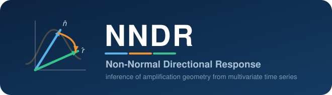

<p align="center">
  
</p>

# NNDR — Non-Normal Directional Response inference

**V. R. Saiprasad, V. Troude, D. Sornette**

[](https://www.python.org/) [](LICENSE)

NNDR is a Python toolkit for inferring non-normal amplification geometry from multivariate time series. It estimates a local linear predictor, extracts a two-dimensional response plane and quantifies its spectral and directional geometry. A stable spectrum can coexist with transient growth; the toolkit reports the revised variance-response criterion `R_A` and the exact discrete one-step criterion `R_sigma` separately.

## Installation

Python 3.9 or newer. From the repository root on the revised branch:

```bash
python -m venv .venv
source .venv/bin/activate
python -m pip install -e '.[dev]'
```

On Windows use `.venv\Scripts\activate` instead. For the minimal NumPy-only core, use `python -m pip install -e .`; matrix exponential/logarithm, surrogate and statistical functions require SciPy. The `dev` extra installs SciPy, pandas, Matplotlib and pytest. For an existing environment, do not recreate it. See the [installation guide](docs/quickstart.md) for the validated macOS constraints. A PyPI release is not assumed here.

## Quick start

```python
import nndr

L = nndr.complex_generator(gamma=1.0, omega=2.0, K=1.5)
F, Q_true = nndr.embedded_map(L, dimension=12, dt=0.1, seed=1)
X = nndr.simulate_trajectory(F, samples=5000, seed=2)
res = nndr.analyze(X, method="M3", dt=0.1, lam_rel=0.003, shrinkage=0.04)
print(res.summary())
print(res.R_A, res.R_sigma, res.support)
```

For your own recording, replace `X` with a finite real NumPy array of shape `(channels, samples)` and use its actual sampling interval. Centering, filtering and channel scaling are explicit application choices. Relative ridge 0.003 is an illustrative setting, not a universal recommendation.

For direct comparison of M2 and M3, fit once and use the same operator:

```python
Fhat = nndr.fit_operator(X, lam_rel=0.003, shrinkage=0.04)
a = nndr.analyze_operator(Fhat, method="M2", dt=0.1)
b = nndr.analyze_operator(Fhat, method="M3", dt=0.1)
print(nndr.principal_angle(a.Q, b.Q))
```

`analyze_operator` expects a **discrete map**, not a continuous generator. Use `scipy.linalg.expm(L * dt)` for a known continuous system. Run the full worked example from the repository root:

```bash
python examples/tutorial_nndr.py
```

## Documentation

| Guide | Contents |
|---|---|
| [Quick start](docs/quickstart.md) | Installation, known operators, time series and rolling windows |
| [Mathematical framework](docs/mathematical_framework.md) | Estimation, plane extraction, real/complex thresholds and support |
| [Public API reference](docs/api_reference.md) | Function signatures, return values and domains |
| [Tutorial](docs/tutorial.md) | Worked synthetic and general experimental workflows |
| [Limitations](docs/limitations.md) | Interpretation, identifiability, statistical controls and compatibility |
| [Scientific geometry](docs/scientific_api.md) | Direction ordering and observable alignment |
| [Estimation and adequacy](docs/estimation_adequacy.md) | Response gains and predictive diagnostics |
| [Statistical controls](docs/statistical_controls.md) | Nulls, bootstrap and branch selection |
| [Reproducibility](reproducibility/README.md) | Two synthetic validations and representative EEG reproduction; other dataset methods |
| [Threshold migration](THRESHOLD_MIGRATION.md) | Historical conventions and revised diagnostics |

## Methods and interpretation

M1 is an eigenbasis-SVD baseline; M2 uses alternating directed-coupling optimization; M3 extracts a commutator plane and orders its response/input directions. M2 and M3 agreement checks sensitivity to the extraction rule, not the accuracy of their common fitted operator. M2 is not a certified global optimizer.

For an admissible stable reduced map, `R_A > 1` indicates a delayed increasing interval in the isotropic impulse variance-response kernel. It need not exceed its initial value. `R_sigma > 1` is equivalent to `sigma_max(Gamma) > 1` for stable `Gamma`. The default `R` is `R_A`; undefined ratios are NaN, not zero. Full and reduced stability are distinct. The default reaction support is normalized L1 support; the frozen EEG figure uses entropy support and discrete multiplier splitting instead. Neither threshold is a clinical boundary or proof of causation.

## Reproduction and tests

```bash
python -m pip check
python -m pytest -v -W error::RuntimeWarning
python reproducibility/synthetic/validate_thresholds.py --out results/synthetic/thresholds
python reproducibility/synthetic/validate_recovery.py --out results/synthetic/recovery
```

The synthetic experiments are new validation examples for the revised framework, not exact regenerations of all original preprint figures. The [representative EEG example](reproducibility/seizure/representative/README.md) includes frozen plotting data and an EDF numerical parity audit. MNE is needed only for the EDF route. Raw EEG data are downloaded from PhysioNet rather than bundled. The original [push-up recording](data/pushup/) is included; no full revised push-up or cohort pipeline is claimed.

## Citation

```bibtex
@article{saiprasad2026nndr,
  title = {Inferring Non-Normal Amplification Geometry from Multivariate Time Series},
  author = {Saiprasad, V. R. and Troude, V. and Sornette, D.},
  year = {2026},
  note = {Preprint. V. R. Saiprasad and V. Troude contributed equally.},
  eprint = {2607.14786},
  archivePrefix = {arXiv},
  primaryClass = {nlin.CD}
}
```

Software: [MIT license](LICENSE). External datasets retain their own licenses and attribution requirements. Report the exact software commit, preprocessing, sampling interval, estimator settings and random seeds with results.
