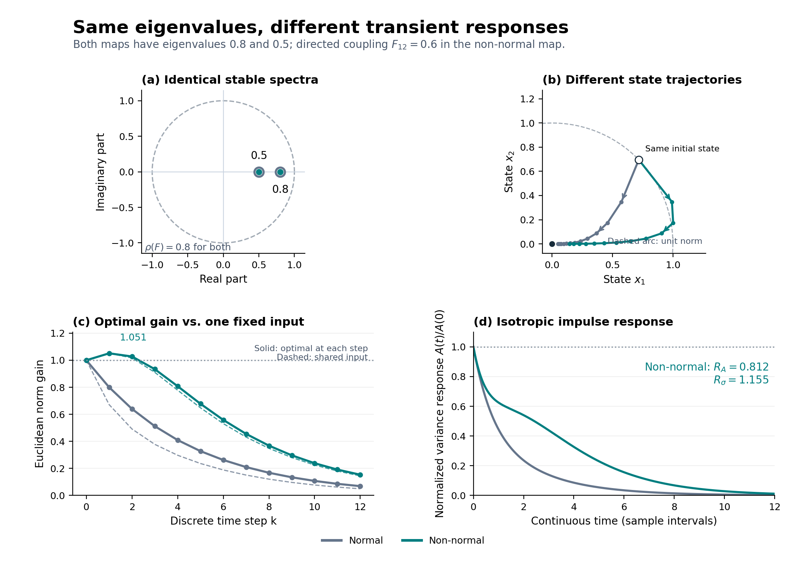

# 01 — Why eigenvalues are not enough

[All examples](../README.md) · [Understanding NNDR](../../docs/understanding_nndr.md) · [API reference](../../docs/api_reference.md)

**Question:** Can two asymptotically stable systems with identical eigenvalues respond differently to a perturbation?

**Answer:** Yes. The spectrum determines asymptotic decay, but the geometry of the map determines how perturbations can grow before decaying. This example needs neither experimental data nor operator estimation.



[Vector version](figures/comparison.svg) · [Runnable Python script](run.py)

## 1. Model: identical spectra, different coupling

Consider a two-dimensional discrete map, with one time unit between samples:

$$
x_{k+1}=Fx_k,\qquad F_{\mathrm{N}}=\begin{pmatrix}0.8&0\\0&0.5\end{pmatrix},\qquad F_{\mathrm{NN}}=\begin{pmatrix}0.8&0.6\\0&0.5\end{pmatrix}.
$$

Both eigenvalues lie inside the unit circle. The first map is normal; the second is non-normal because directed coupling transfers the second coordinate into the first. Here the entire state space is already two-dimensional, so no response-plane extraction is needed. This lets us isolate the amplification diagnostics from estimation and plane recovery. In higher dimensions, the extraction methods select the compression to which these diagnostics are applied.

## 2. Calculate the quantities using NNDR

```python
import numpy as np
import nndr

F = np.array([[0.8, 0.6], [0., 0.5]])
d = nndr.threshold_diagnostics(F, dt=1.0)

print(nndr.spectral_radius(F))  # asymptotic stability
print(nndr.optimal_gain(F, 1))  # maximum one-step norm gain
print(d['R_A'], d['R_sigma'])   # distinct amplification criteria
```

The maximal norm response at step $k$ is $G(k)=\|F^k\|_2$. Each step may have a different maximizing input; the solid lines in panel (c) are not a single trajectory. To obtain the input maximizing one-step gain, use `nndr.snapshot_gain(F, 1)['v']`. The example applies this same unit vector to both maps and follows both trajectories, without forcing or noise.

The real principal logarithm of the map, divided by the sampling interval, defines an associated continuous generator. For this example the logarithm is admissible. The isotropic impulse covariance response is $A(t)=\|e^{Lt}\|_F^2$ for $L=\log(F)$ and unit initial covariance. The plot displays $A(t)/A(0)$ so that both curves start at one.

```python
from scipy.linalg import logm
L = logm(F).real  # this particular map has a real principal logarithm
print(nndr.variance_response(L, 0.5, continuous=True))
```

## 3. Interpret the figure

| Panel | What to look for |
|---|---|
| (a) Identical stable spectra | The two sets of eigenvalues coincide. Both maps have spectral radius 0.8. |
| (b) Different state trajectories | With the same unit input, the non-normal trajectory initially leaves the unit circle before decaying. The normal trajectory stays inside it. |
| (c) Norm gain | The non-normal optimal norm gain exceeds one at steps 1 and 2. The dashed curves track the single shared input, not the optimum at each horizon. |
| (d) Isotropic response | Both variance-response curves decrease. The non-normal response decays more slowly over the displayed interval, but has no increasing interval. |

| Diagnostic | Normal | Non-normal |
|---|---:|---:|
| Spectral radius | 0.8000 | 0.8000 |
| Largest singular value | 0.8000 | 1.0513 |
| Optimal two-step norm gain | 0.6400 | 1.0277 |
| Henrici departure | 0.0000 | 0.6000 |
| `R_A` | 0.0000 | 0.8122 |
| `R_sigma` | 0.0000 | 1.1547 |

The non-normal map has `R_sigma > 1`: at least one unit perturbation grows in one sample interval. It has `R_A < 1`: the continuous isotropic impulse variance-response kernel has no delayed increasing interval. These results are consistent because the first statement concerns an optimal input and the second concerns an isotropic ensemble.

Neither diagnostic is an observed variance or a causal claim. For a general fitted high-dimensional map, both ratios apply to the chosen two-dimensional compression, not automatically to the full system. See the [mathematical framework](../../docs/mathematical_framework.md).

## 4. Run and explore

From the repository root, in an environment with NNDR and the `dev` extras installed:

```bash
python examples/01_why_non_normality_matters/run.py
```

The output directory `results/examples/01_stability/` contains PNG and SVG plots, the discrete gains and trajectories in `discrete_response.csv`, the continuous response in `variance_response.csv`, and `summary.json` with the matrices, initial state and diagnostics.

Now increase the coupling without changing the eigenvalues:

```bash
python examples/01_why_non_normality_matters/run.py \
  --coupling 0.9 --out results/examples/01_stronger_coupling
```

The reference calculation gives `R_A = 1.2183` and `R_sigma = 1.7321`. A delayed increasing interval now appears in the continuous variance response, although it does not exceed the initial value. Try coupling zero as a negative control. The eigenvalues remain fixed in all three cases.

## 5. What this example establishes

Non-normality matters even when asymptotic stability is not in question. The example shows why stability, norm gain and isotropic variance response must be distinguished. It uses known two-dimensional maps, so it does **not** test finite-sample estimation, response-plane recovery, or statistical significance. Subsequent examples address those problems.

**Functions used:** `threshold_diagnostics`, `spectral_radius`, `sigma_max`, `departure_from_normality`, `optimal_gain`, `snapshot_gain`, `variance_response`.
