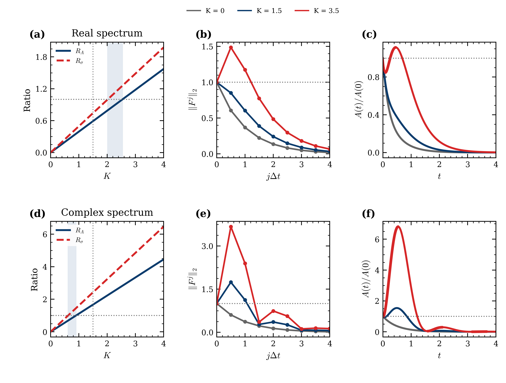
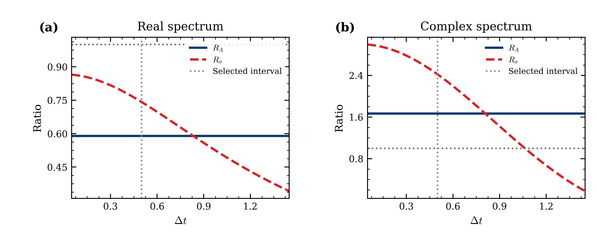

# 02 — Real and complex spectra

[Example gallery](../README.md) · [Example 01](../01_why_non_normality_matters/README.md) · [Mathematical framework](../../docs/mathematical_framework.md)

## Scientific question

Is a given amount of eigenvector non-orthogonality sufficient to predict amplification? Not by itself. The relative decay rates, oscillation frequency and sampling interval also matter. Here we hold the slow decay rate fixed and vary the non-normality index of two canonical systems. No operator estimation or external data are required.

## Two controlled models

Consider the continuous dynamics $\dot{x}=Lx$. The real-spectrum generator is

$$
L_{\mathrm{real}}=\begin{pmatrix}-\gamma_1 & K(\gamma_2-\gamma_1)\\0 & -\gamma_2\end{pmatrix}.
$$

Set $\gamma_1=1$ and $\gamma_2=3$. Its eigenvalues are $-1,-3$, and its decay-rate splitting is $\Delta_{\mathrm{rate}}=0.5$.

The complex-spectrum generator is

$$
L_{\mathrm{complex}}=\begin{pmatrix}-\gamma & \omega e^\eta\\-\omega e^{-\eta} & -\gamma\end{pmatrix},\qquad \eta=\mathrm{asinh}(K).
$$

Set $\gamma=1$ and $\omega=2$. Its eigenvalues are $-1\pm 2i$, and $\beta=\omega/\gamma=2$. Both models have the same slow decay rate. Increasing $K\ge 0$ leaves each spectrum fixed, but changes the geometry of the eigenvectors. Both models are normal at $K=0$.

Sample either system using $F=e^{L\Delta t}$, initially with $\Delta t=0.5$. This gives the same spectral radius $e^{-0.5}\approx0.607$ in both families, independent of $K$.

## Analyze the operators using NNDR

```python
import nndr
from scipy.linalg import expm

K, dt = 1.5, 0.5
models = {
    'real': nndr.real_generator(1., 3., K),
    'complex': nndr.complex_generator(1., 2., K),
}
for name, L in models.items():
    F = expm(L * dt)
    d = nndr.threshold_diagnostics(F, dt=dt)
    print(name, d['Kc_A'], d['Kc_sigma'], d['R_A'], d['R_sigma'])
    print('One-step norm gain:', nndr.optimal_gain(F, 1))
```

The full two-dimensional system is already the response space; there is no need to estimate a plane. The package computes both ratios from the sampled operator. `critical_K_real(0.5)` and `critical_K_complex(2.)` return the corresponding continuous variance-response thresholds.

## Results: the same K is not the same regime



[Vector SVG](figures/spectral_comparison.svg) · [Vector PDF](figures/spectral_comparison.pdf)

Each row shows the threshold ratios versus $K$, optimal sampled norm gain $\|F^j\|_2$, and normalized isotropic variance response $A(t)/A(0)$, where $A(t)=\|e^{Lt}\|_F^2$. Grey shading marks the range where the two strict threshold classifications differ (excluding boundary equality). The thick red portions show positive derivatives for $K=3.5$ on the evaluated continuous-time grid.

For the default sample interval:

| Quantity | Real rates | Complex rates |
|---|---:|---:|
| Spectral radius | 0.6065 | 0.6065 |
| Critical K for variance response | 2.5425 | 0.8995 |
| Critical K for one-step growth | 2.0214 | 0.6193 |
| R_A at K = 1.5 | 0.5900 | 1.6677 |
| R_sigma at K = 1.5 | 0.7421 | 2.4222 |
| One-step norm gain at K = 1.5 | 0.8503 | 1.7423 |

For these particular models, the oscillatory system crosses both thresholds at smaller K. This is not a universal ranking of complex and real spectra: their critical values depend on the rates. In the strong-coupling case K = 3.5, both systems exhibit an increasing variance-response interval. Note that the ratios are not gain magnitudes. An increasing interval can also exist without the kernel exceeding its initial value.

## Sampling matters even when the physical model is unchanged



[Vector SVG](figures/sampling_effect.svg) · [Vector PDF](figures/sampling_effect.pdf)

Keep the physical generators and K = 1.5 fixed, and change only the sample interval. As long as the principal logarithm recovers the original generator, `R_A` remains constant. `R_sigma` changes because it measures growth across one sample interval. At $\Delta t=1.4$, the complex example has `R_A` approximately 1.6677 but `R_sigma` approximately 0.2639: the sampled one-step map contracts every Euclidean unit perturbation, although the continuous model still has an increasing variance-response interval.

This is not a contradiction. A coarse sample interval can miss transient behavior occurring between samples. The plotted complex intervals satisfy $\omega\Delta t<\pi$; this deliberately avoids logarithm-branch aliasing. In measured data the true continuous frequency may be unknown.

## Run and explore

From the repository root with the `dev` dependencies installed:

```bash
python examples/02_real_and_complex_spectra/run.py --out results/examples/02
python examples/02_real_and_complex_spectra/run.py --dt 1.4 --out results/examples/02_coarse
```

The script checks eigenvalue stability, recovery of the prescribed K, agreement with the public critical-K functions, the one-step classification against the singular value, and the variance classification of the six illustrated cases against a sampled independent derivative calculation. This finite grid is a demonstration, not a proof for all parameters. The output contains two PNG/SVG/PDF figures, `threshold_sweep.csv`, `response_curves.csv`, `sampling_sweep.csv` and `summary.json`. The included figures use the default interval. No data download or stochastic realization is needed.

Try changing `--dt` within the supported interval [0.05, 1.45]. To explore other decay rates and frequencies, edit the model definitions and update the fixed-case checks accordingly. Use an alias-free sampling interval for complex rates.

## Takeaway

Use `R_A` for the continuous variance-response question and `R_sigma` for discrete one-step Euclidean growth. A stable spectrum does not rule out either. Neither ratio measures the maximum possible gain at every time, and neither implies causation or a physical instability. These known two-dimensional models do not test recovery from noisy high-dimensional observations; the next example will address inference.
