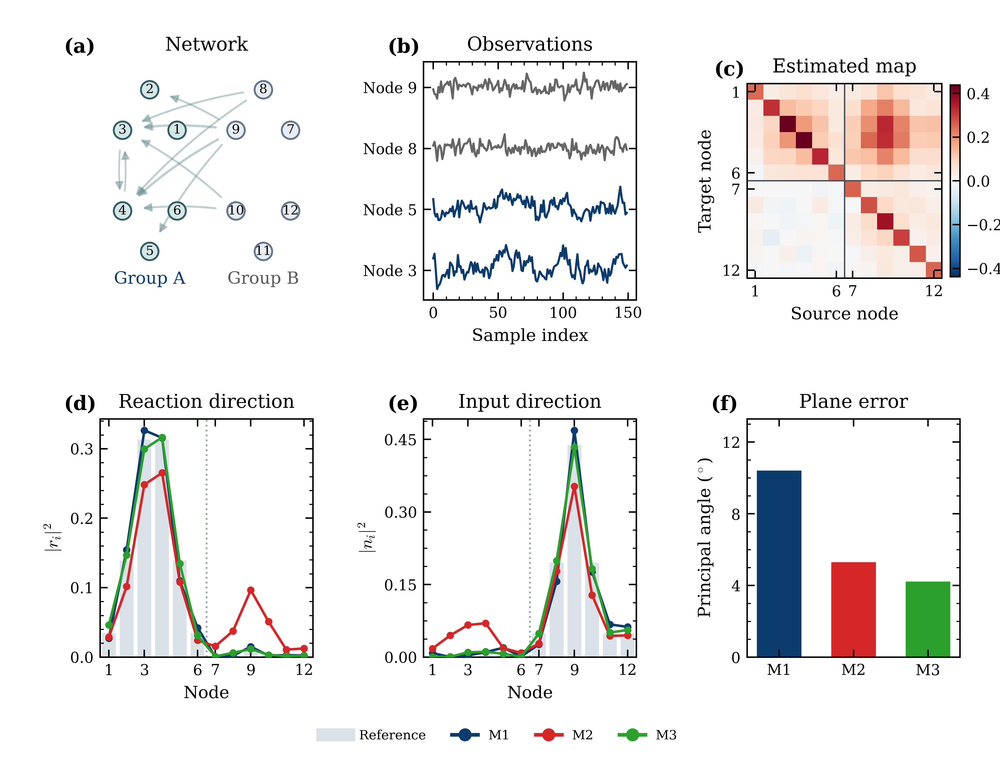
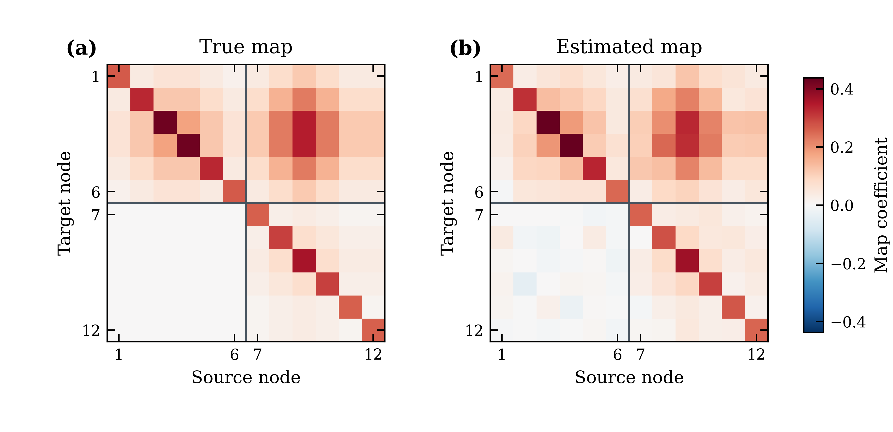

# 03 — Discover hidden amplification directions in a network

[Example gallery](../README.md) · [User guide](../../docs/user_guide.md) · [API reference](../../docs/api_reference.md)

## Scientific question

If a network is stable but can amplify perturbations, which combinations of nodes receive and transmit that amplification? Can we recover those combinations from measurements alone?

Unlike the first two examples, the operator is not supplied to the inference step. We simulate a known directed network, observe its nodes, estimate the operator, and compare the inferred plane with the known one. The model is deliberately simple so we can isolate errors in estimation and extraction. This is an educational example, independent of the manuscript benchmarks.



[Vector PDF](figures/network_inference.pdf) · [Vector SVG](figures/network_inference.svg)

*Figure 1. The plotted edges have non-self weights at least 0.16 (all weights enter the simulation). Node signals are offset for legibility. The estimated operator uses source columns and target rows. Squared direction components remove arbitrary signs. The reference directions are ordered by maximum directed coupling within the planted plane. M1 and M2 display their native directions; M3 displays the ordered commutator directions. Panel (f) measures recovery of the plane, not of individual basis vectors.*

## 1. Construct a controlled directed network

The discrete-time model is

$$
x_{k+1}=F x_k+\epsilon_k,\qquad \epsilon_k\sim\mathcal{N}(0,0.1^2 I_{12}).
$$

The 12 nodes belong to two groups of six. Let $a$ and $b$ be unit vectors supported on the first and last six nodes, respectively. Their within-group unnormalized weights are $(1,2,3,3,2,1)$ and $(1,2,3,2,1,1)$. With $Q_0=[a,b]$,

$$
G=\begin{pmatrix}0.8&0.9\\0&0.5\end{pmatrix},\qquad F=0.25 I_{12}+Q_0(G-0.25 I_2)Q_0^\top.
$$

The entry $F_{ij}$ is the influence of source node $j$ on target node $i$ over one step. There is one-way cross-group coupling from B to A, and the complementary ten-dimensional subspace decays with multiplier 0.25. The two-dimensional plane is exactly invariant: $FQ_0=Q_0G$. All eigenvalues have magnitude below one; the largest is 0.8. This is a deliberately constructed effective map, not an inferred physical adjacency matrix or a realistic network generative model.

The planted basis is not necessarily the directed basis of NNDR. We use `order_response_plane(F, Q0)` to define the reference reaction and input directions within the known plane. Their overall signs are immaterial for the squared weights.

## 2. Infer from the observations

Generate 5,000 samples after 500 burn-in steps using Gaussian process innovations and seed 2. Treat $F$ and $Q_0$ as unknown during estimation. The record `X` has shape `(12, 5000)` and sampling interval one time unit.

```python
import nndr

# X is the observed record, shaped (channels, samples).
Fhat, info = nndr.fit_relative_operator(
    X, lam_rel=0.003, shrinkage=0.0, return_info=True
)
methods = {
    'M1': nndr.method1(Fhat, dt=1.0),
    'M2': nndr.method2(Fhat, dt=1.0),
    'M3': nndr.method3(Fhat, dt=1.0),
}
for name, result in methods.items():
    d = result['diagnostics']
    print(name, d['R_A'], d['R_sigma'])
```

The known map is used only to generate observations and evaluate recovery. All three methods operate on exactly the same fitted map. Relative ridge is fixed at 0.003; shrinkage is disabled here so regularization does not add isotropic-shrinkage bias. No stability rescaling or per-channel normalization is applied. These settings are illustrative, not universal defaults.



[Vector PDF](figures/operator_comparison.pdf) · [Vector SVG](figures/operator_comparison.svg)

*Figure 2. True and estimated matrices on identical signed color scales. The upper-right block encodes cross-group coupling. Small fitted entries outside the planted pattern reflect finite-data error. NNDR does not perform sparse graph reconstruction or establish causality.*

## 3. Interpret the reduced geometry

The default seeded run gives the following reference values (small numerical differences across libraries and platforms are possible).

| Method | Largest plane angle to truth | $R_A$ | $R_\sigma$ | Reaction-direction overlap | Reaction support |
|---|---:|---:|---:|---:|---:|
| Planted reference | 0 degrees | 1.2183 | 1.7321 | 1.0000 | 0.7496 |
| M1 | 10.42 degrees | 1.1879 | 1.6762 | 0.9967 | 0.7356 |
| M2 | 5.30 degrees | 1.1924 | 1.6804 | 0.7936 | 0.8822 |
| M3 | 4.21 degrees | 1.1944 | 1.6844 | 0.9992 | 0.7520 |

The fitted full-map spectral radius is 0.7818 and its relative Frobenius error is 0.1086. The M2/M3 plane angle is 3.02 degrees. The estimated ratios agree on amplification in this particular realization. However, the M2 reaction direction differs considerably from the reference despite the good plane estimate. M2 uses alternating optimization, not a certified global directional optimum; M3 orders the basis within its commutator plane. Do not infer direction agreement from plane agreement alone.

For a unit reference reaction direction $r_*$ and estimate $\hat r$, the sign-invariant overlap is $|\hat r^\top r_*|$. Reaction support is the package's normalized L1 measure, not the entropy-based support of the archived seizure figure. The plots show $|\hat r_i|^2$ and $|\hat n_i|^2$; each identifiable unit direction has weights summing to one. A large weight identifies participation in the chosen coordinates, not an independently demonstrated causal node. If M3 flags a direction as unidentifiable, the script omits its plotted weights and reports missing direction metrics. M1 and M2 have no corresponding identifiability flag; a missing flag is not a positive certificate.

Additional output fields include capture fraction (reduced/full one-step gain), mean-field alignment, fitted-map conditioning and spectral admissibility. Alignment is descriptive, not out-of-sample prediction. The true plane is unavailable in empirical data; report M2/M3 agreement, model adequacy, stability and sensitivity instead of ground-truth errors.

## 4. Try it yourself: reduce the available data

From the repository root, after installing `.[dev]`:

```bash
python examples/03_inference_from_network_data/run.py --out results/examples/03_network
python examples/03_inference_from_network_data/run.py --samples 500 --out results/examples/03_network_short
```

| Method | 500 samples: plane error | 5,000 samples: plane error |
|---|---:|---:|
| M1 | 47.18 degrees | 10.42 degrees |
| M2 | 10.48 degrees | 5.30 degrees |
| M3 | 10.20 degrees | 4.21 degrees |

The relative operator error changes from 0.3630 to 0.1086. The short run uses the same seed and burn-in, so its observations are a prefix of the long run. This is one realization, not an independent repeated-trial benchmark or proof of a universal method ranking. Try `--seed 3`, or additional sample sizes, and inspect the sensitivity. The manuscript folder contains the systematic recovery benchmark.

## 5. Outputs and reuse

The script writes both figures as PNG, SVG and PDF, `summary.json`, `method_diagnostics.csv`, `true_operator.csv`, `estimated_operator.csv`, `observations.csv`, and `direction_weights.csv`. JSON uses null for nonfinite values or unavailable flags; no missing results are silently converted to zero. Use the exported data to inspect a particular node, reproduce the plotted weights, or compare with a different model. All results use public NNDR functions for estimation and diagnostics; network construction and plotting are example-specific.

For your own recordings replace the simulation with a regularly sampled real array and specify the actual sampling interval. Explicitly document units, preprocessing, model order and regularization. This example uses fully observed linear dynamics with additive white innovations. Partial observation, nonlinear dynamics, measurement noise and colored forcing can make the fitted operator an inadequate description.
