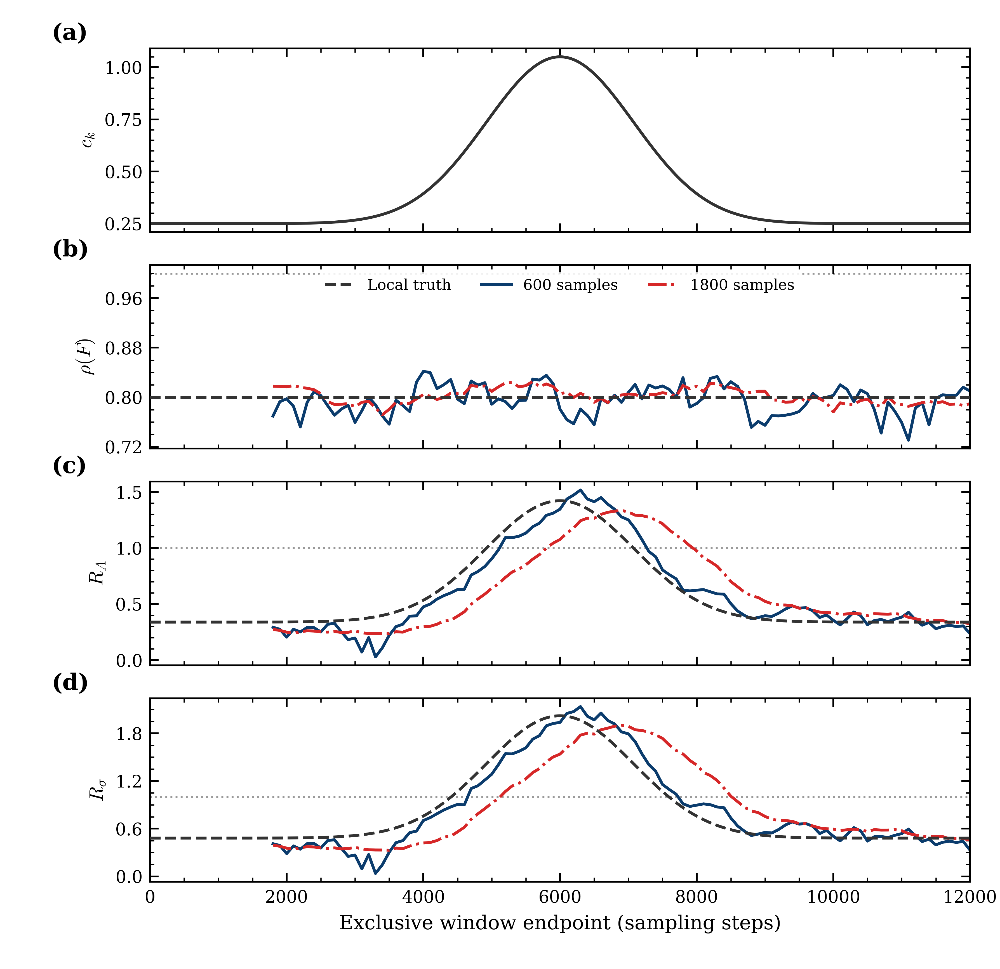

# 04 — Time-varying dynamics

[Example gallery](../README.md) · [User guide](../../docs/user_guide.md) · [API reference](../../docs/api_reference.md)

## Scientific question

Can an amplification diagnostic change while all instantaneous eigenvalues remain fixed? How does the length of a trailing estimation window affect the result?

A local linear estimate combines information across a finite interval. A longer window may improve estimation of the response plane but blur changes in the dynamics. This example makes that trade-off visible using a system with known local operators, rather than interpreting an unknown experimental event.

## Model

The eight-dimensional state follows a time-dependent VAR(1) model: $x_{k+1}=F_k x_k+\epsilon_k$. The innovations are independent Gaussian vectors with covariance $0.1^2 I_8$. Time is measured in sampling steps ($\Delta t=1$).

Two orthonormal vectors, supported on disjoint groups of four nodes, form the columns of $Q$:

$$
q_1=(1,2,3,4,0,0,0,0)^\top/\sqrt{30},\qquad
q_2=(0,0,0,0,4,3,2,1)^\top/\sqrt{30}.
$$

The local map is

$$
F_k=0.25 I_8+Q(G_k-0.25 I_2)Q^\top,\qquad
G_k=\begin{pmatrix}0.8&c_k\\0&0.5\end{pmatrix}.
$$

The coupling pulse is $c_k=0.25+0.8\exp[-(k-T/2)^2/(2(0.09T)^2)]$, where $T=12000$ by default. All local maps have eigenvalues 0.8, 0.5 and 0.25 (sixfold). The planted invariant plane is constant. Only the coupling, and hence the non-normality strength, changes. Instantaneous spectral stability is not in general a guarantee of stability for arbitrary time-varying systems; this example is a bounded, triangular-block construction with fixed decaying diagonal modes.

## Analysis

The estimator sees the observations, not the planted map or plane. We use M3 on a relative-ridge estimate, with ridge coefficient 0.003 and no shrinkage. The zero-mean model is analyzed without sample demeaning. The default windows contain 600 or 1800 samples, with a common step of 100 samples. Estimates for both lengths are calculated at common endpoints, beginning at the longer window length.

```python
import nndr

# X is the generated array, shape (8, T).
# e is a chosen exclusive endpoint, w is the window length.
Fhat = nndr.fit_relative_operator(X[:, e-w:e], lam_rel=0.003,
                                  shrinkage=0.0)
m = nndr.method3(Fhat, dt=1.0)
print(m['diagnostics']['R_A'], m['diagnostics']['R_sigma'])
print(m['plane_identifiable'])
```

The script uses this explicit loop so the estimated plane, fit conditioning and reference comparison can all be exported. For ordinary rolling diagnostics without these extra quantities, use `nndr.rolling_analyze(X, window=600, step=100, method='M3', dt=1., lam_rel=.003, shrinkage=0.)`. Its endpoint grid begins at the specified window length, rather than the common longer-window endpoint used here.

The fit uses observed adjacent pairs within `[e-w,e)`. Its final observed sample is `e-1`, its final predictor is `e-2`, and its plotted boundary is `e`. The black reference curve is the diagnostic of the frozen local map at that boundary, not the exact population regression over the window. It is a reference for tracking error, including temporal averaging, estimation error and regularization bias. The rate-based ratio is a frozen-map diagnostic, not a guarantee about the actual nonautonomous evolution. No future sample enters the fit.

## Results



[PDF](figures/time_varying_dynamics.pdf) · [SVG](figures/time_varying_dynamics.svg)

**Figure.** (a) Prescribed coupling. (b) Full-map spectral radius. (c) Reduced variance-response ratio. (d) Reduced one-step amplification ratio. Black dashed curves are the instantaneous reference; blue solid and red dash-dotted curves are trailing-window M3 estimates using 600 and 1800 samples. Dotted lines indicate unity. The first panel shows the prescribed coupling, not an estimated signal. All estimates are plotted at exclusive endpoints; no smoothing or interpolation has been applied to the estimated traces. Undefined numerical diagnostics remain missing. The default run has 103 windows per length with stable full and reduced maps and identifiable M3 planes. This is one seeded realization, not independent replication across windows.

| Diagnostic | Instantaneous reference | 600 samples | 1800 samples |
|---|---:|---:|---:|
| Peak $R_A$ | 1.421 | 1.517 | 1.335 |
| Peak $R_\sigma$ | 2.021 | 2.137 | 1.902 |
| Peak endpoint (both ratios) | 6000 | 6300 | 6900 |
| RMSE of $R_A$ relative to endpoint truth | — | 0.116 | 0.256 |
| RMSE of $R_\sigma$ relative to endpoint truth | — | 0.166 | 0.362 |
| Median largest plane angle (degrees) | 0 | 24.83 | 15.27 |

The local spectral radius stays at 0.8, but the amplification ratios cross unity as the coupling increases. The shorter window tracks the change more closely; the longer window has a later, lower peak and a smaller median plane angle in this realization. Thus a more accurate estimated plane need not yield a more accurate instantaneous amplification estimate. A finite window cannot be assumed to measure an instantaneous transition. The observed offsets of 300 and 900 steps are descriptive peak offsets, not universal detection delays. A crossing of either ratio is not evidence of causal instability or a calibrated event-prediction rule.

## Run and explore

From the repository root, install the `dev` extras and run:

```bash
python -W error::RuntimeWarning examples/04_time_varying_dynamics/run.py --out results/examples/04
```

Try shorter and longer windows while holding the model and random seed fixed:

```bash
python -W error::RuntimeWarning examples/04_time_varying_dynamics/run.py --window-short 300 --window-long 2400 --out results/examples/04_alternative
```

The second run starts at a different common endpoint, so compare its two lengths on that common grid; cross-run summary errors are not evaluated over identical intervals. Try `--seed 5` to see the effect of finite-data variability. `--samples`, `--step`, `--window-short`, and `--window-long` control the simulation and window grid. Changing `--samples` also changes the duration of the coupling pulse. Choose windows based on the physical time scales of the problem, not retrospectively to maximize an amplification peak.

Outputs: `observations.csv`, `local_truth.csv` (dense reference grid), `window_diagnostics.csv` (including admissibility and identifiability flags), `summary.json`, and the figure in PNG, SVG and PDF. CSV values retain full precision; nonfinite JSON values are `null`. The reference figure uses the shared [figure style](../FIGURE_STYLE.md). No external datasets are required.

The model is deliberately simple, with full observation, known coordinates, isotropic innovations and fixed planted plane. Weak non-normal coupling can make direction estimation poorly conditioned even with a formally identifiable plane. Overlapping windows are dependent and the reported median angles and RMSEs are descriptive, not uncertainty intervals. See [validation and uncertainty](../../docs/validation_and_uncertainty.md) before interpreting unknown experimental data.
