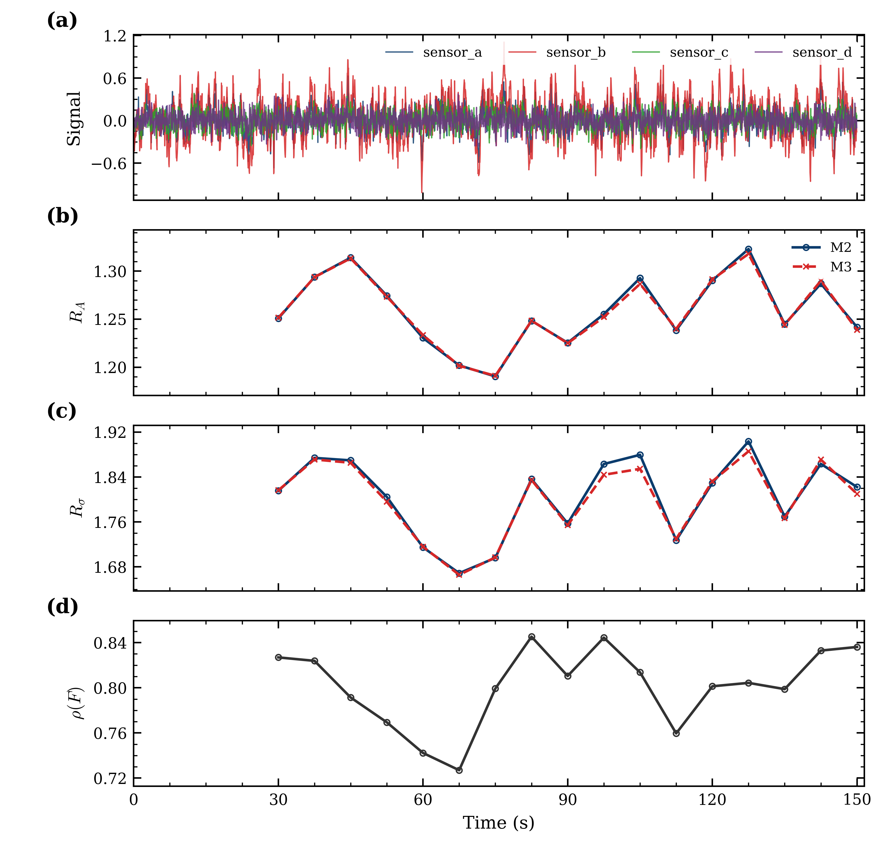
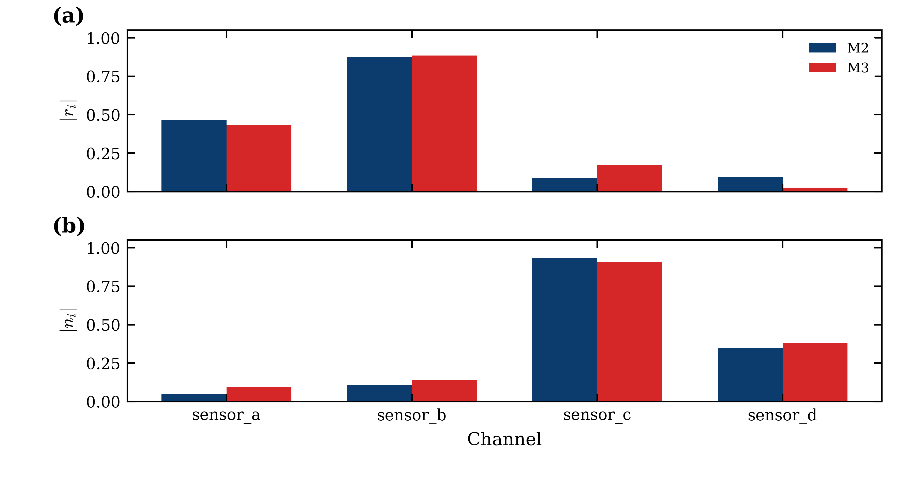

# 05 — Analyze your own experimental data

[Example gallery](../README.md) · [User guide](../../docs/user_guide.md) · [API reference](../../docs/api_reference.md)

## Scientific question

How can we infer amplification geometry when we have a multichannel recording but no governing equations? This example provides a configurable, offline analysis of a numeric CSV. It fits one local predictor per trailing window, applies M2 and M3 to that same map, and exports the estimated quantities and diagnostic flags. The demo is synthetic, not a clinical or experimental validation.

## 1. Start with a working recording

From the repository root, with the package and its `dev` extras installed:

```bash
python examples/05_analyze_your_own_data/run.py --out results/examples/05
```

The bundled [demo recording](data/demo_recording.csv) contains 3,000 observations of four channels at 20 Hz, in arbitrary but common units. It can be regenerated with `python examples/05_analyze_your_own_data/generate_demo.py --out results/demo_recording.csv`.

The stationary generating process is $x_{k+1}=Fx_k+\epsilon_k$. Let $Q$ have columns $(1,2,0,0)^\top/\sqrt{5}$ and $(0,0,2,1)^\top/\sqrt{5}$. The generating map is $F=0.25I+Q(G-0.25I_2)Q^\top$, with

$$
G=\begin{pmatrix}0.8&0.9\\0&0.5\end{pmatrix}.
$$

Its spectral radius is 0.8. Innovations are independent isotropic Gaussian samples with standard deviation 0.1, burn-in 500, seed 12. The analysis receives only the CSV; the generating map is not an input to inference. All sensors have the same units. The figures are generated from the actual analysis, not diagrams.

## 2. Replace the recording

Use a CSV with one observation per row and numeric timestamps in seconds. For example:

```csv
time,sensor_a,sensor_b,sensor_c
0.00,0.12,-0.08,0.02
0.05,0.18,-0.04,0.01
0.10,0.21,0.02,-0.03
```

These three rows illustrate the format only; a real analysis requires many more samples. Select channels explicitly if the file has other columns.

```bash
python examples/05_analyze_your_own_data/run.py \
  --csv path/to/recording.csv \
  --time-column time \
  --channels sensor_a sensor_b sensor_c \
  --window 600 --step 150 \
  --method both --lam-rel 0.003 --shrinkage 0.0 \
  --centering window --out results/my_recording
```

The script checks unique column names, rectangular rows, finite numeric measurements, strictly increasing timestamps, regular sampling, and consistency with an explicitly supplied `--dt`. If the file contains only regularly sampled channel values, use `--no-time-column --dt 0.05`. This assumes the supplied interval is correct; regularity cannot be verified without timestamps. `--channels` defaults to all columns except the designated time column. A minimum of two channels is required.

| Option | Meaning |
|---|---|
| `--csv` | Input file; defaults to the bundled demo |
| `--time-column` | Numeric timestamp column, in seconds |
| `--no-time-column --dt` | Supply a known sample interval in seconds |
| `--channels` | Space-separated measurement column names, in desired order |
| `--window`, `--step` | Window length and step, in **samples**, not seconds |
| `--method` | `M2`, `M3`, or `both` (default) |
| `--lam-rel` | Nonnegative relative ridge coefficient; default 0.003 is illustrative |
| `--shrinkage` | Trace-preserving isotropic shrinkage in [0,1); default 0 |
| `--centering` | `window` (default) or `none` |
| `--out` | Output directory |

Choose a scientifically meaningful window length and enough observations relative to the dimension. For a large number of channels, choose relevant comparable measurements; the overlay and direction plot are intended for modest channel counts. This script does not filter, interpolate, normalize or fill missing values. Perform justified preprocessing separately, including anti-aliasing before downsampling, and record it with the results. Relative channel scaling changes the norm and hence the response geometry. Centering removes the local sample mean but is not a substitute for a justified stochastic model.

## 3. What the code does

The central inference step is intentionally short:

```python
import nndr

# Z: channels by samples, one window, explicitly centered if desired.
Fhat = nndr.fit_relative_operator(Z, lam_rel=0.003, shrinkage=0.0)
m2 = nndr.method2(Fhat, dt=dt)
m3 = nndr.method3(Fhat, dt=dt)
print(m3['diagnostics']['R_A'], m3['diagnostics']['R_sigma'])
print(nndr.principal_angle(m2['Q'], m3['Q']))
```

Each fit uses observed adjacent pairs. No artificial transition from zero enters the regression. For a window with indices `[start,end)`, the plotted time is the exclusive boundary `t[end-1]+dt`, not the center or the first sample. The initial 30 seconds contain no plotted window estimate in the default run. Overlapping windows are not independent replicates.

## 4. Results



[PDF](figures/recording_analysis.pdf) · [SVG](figures/recording_analysis.svg)

**Figure 1.** (a) Unfiltered synthetic sensor measurements. (b,c) Variance-response ratio $R_A$ and one-step ratio $R_\sigma$, respectively. (d) Spectral radius of the common full fitted map. Each diagnostic axis is scaled to its finite estimates; a dotted reference at one is drawn only if it lies within that range. Markers denote evaluated window endpoints; missing values remain gaps. The shared time axis preserves the initial interval before the first complete window. The window contains 600 samples (30 s), and the step is 150 samples (7.5 s). M2 and M3 are applied to the same estimate, with within-window demeaning, relative ridge 0.003 and no shrinkage. In the stationary demo, variation across windows reflects finite-data estimation, not a changing generating map.

| Quantity | M2 | M3 |
|---|---:|---:|
| Successful extractions | 17/17 | 17/17 |
| Stable full and reduced maps | 17/17 | 17/17 |
| Median $R_A$ | 1.2508 | 1.2514 |
| Median $R_\sigma$ | 1.8222 | 1.8164 |
| Median normalized L1 reaction support | 0.7563 | 0.7581 |

The median M2/M3 plane angle is 1.84 degrees. The two methods give similar plane diagnostics for this particular seeded realization. All the reported full and reduced maps remain stable; a ratio above one is not evidence of spectral instability. See [Example 1](../01_why_non_normality_matters/README.md) for the distinct meanings of the ratios.



[PDF](figures/directions_last_window.pdf) · [SVG](figures/directions_last_window.svg)

**Figure 2.** Absolute components of the inferred reaction direction (a) and input direction (b) for the final evaluated window, spanning 120 to 149.95 s in observed samples, with exclusive endpoint 150 s. Direction signs are arbitrary; the absolute components show relative participation, not signed interaction strengths. Both methods emphasize sensor B in the reaction direction and sensor C in the input direction, consistent with the construction. This is not a statement of causal influence for arbitrary observational data.

## 5. Outputs and interpretation

| File | Contents |
|---|---|
| `window_diagnostics.csv` | One row per method and window: indices, times, both ratios, spectral radii, stability, condition number, rate status, identifiability, support, capture and M2/M3 angle |
| `directions_last_window.csv` | Absolute input/reaction coefficients for each selected channel in the last window, where available |
| `summary.json` | Input checksum, version, channel names, settings, counts, finite-value counts and medians |
| `recording_analysis.{png,svg,pdf}` | Time series and window diagnostics |
| `directions_last_window.{png,svg,pdf}` | Direction components, if available in the last evaluated window |

Undefined values are blank in the CSV and null in JSON. Failed fits/extractions retain their window rows and error text. Explicitly unidentifiable M3 planes have missing plotted ratios; an unidentifiable M3 direction has missing support. M2 does not certify uniqueness, so blank identifiability flags mean **not assessed**, not true. The `status=ok` flag only means extraction completed and no explicit plane-identifiability failure was raised; separately examine full/reduced stability, `rate_status` and finite ratios. The code does not choose a different last window if the final fit fails. Plots leave gaps where values are undefined.

## 6. Try it yourself

```bash
python examples/05_analyze_your_own_data/run.py \
  --channels sensor_a sensor_b sensor_c \
  --window 400 --step 100 --method M3 \
  --out results/examples/05_subset
```

Selecting three channels gives 27 windows with median $R_A=1.1723$ and $R_\sigma=1.7251$ for this particular run. The channel set and temporal estimation settings both change, so the differences cannot be attributed to either choice alone. Change one setting at a time to examine sensitivity.

## Limitations and next steps

The estimated operator is a local linear predictor, not necessarily the physical Jacobian. Similar M2/M3 planes are not independent validation of that operator. Unobserved states, measurement noise, preprocessing, and finite-sample bias can affect the inference. The example demonstrates a descriptive analysis and is not a prediction/detection protocol. Before making quantitative scientific claims, assess model adequacy and use appropriate controls as described in [validation and uncertainty](../../docs/validation_and_uncertainty.md). The median summaries do not treat overlapping windows as independent samples.
