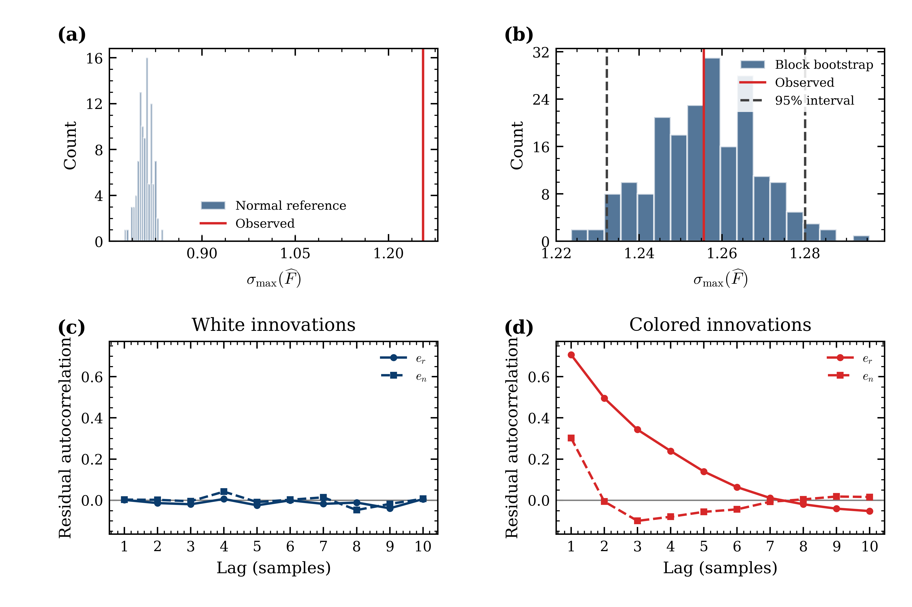

# 06 — Validation and uncertainty

[Example gallery](../README.md) · [Statistical controls](../../docs/statistical_controls.md) · [Model adequacy](../../docs/estimation_adequacy.md)

## Can we trust an inferred amplification ratio?

A fitted map can be stable and non-normal even when its one-step model is inadequate. This example uses a known four-channel VAR(1) system to separate three questions: does the estimated map amplify, is the amplification distinguishable from a fitted normal reference, and do the residuals support the one-step approximation?

Install `.[dev]` from the current checkout and run from the repository root:

```bash
python examples/06_validation_and_uncertainty/run.py --out results/example06
```

The default run uses 3,000 observations, a 500-sample burn-in, seed 2, innovation standard deviation 0.1 and relative ridge 0.003 without shrinkage. The map is

$$
F=\begin{pmatrix}0.8&0.9&0&0\\0&0.5&0&0\\0&0&0.65&0\\0&0&0&0.35\end{pmatrix}.
$$

It has spectral radius 0.8 and largest singular value 1.26491. We generate one record with independent Gaussian innovations and another with temporally correlated innovations (AR(1), coefficient 0.75, stationary marginal SD 0.1). The physical map is unchanged, but the latter observations need not obey a first-order Markov model in the measured coordinates. Both records use the same fitting settings. No physical units are assumed.

## Assess the estimate

```python
import nndr
Fhat = nndr.fit_relative_operator(X, lam_rel=0.003)
m = nndr.method3(Fhat)
P, Y = nndr.adjacent_pairs(X)
E = m['Q'].T @ (Y - Fhat @ P)
a = nndr.model_adequacy(X, Fhat, m['Q'], lam_rel=0.003)
print(a['prediction'], a['lag_errors'])
print(nndr.portmanteau_test(E, max_lag=10))
```

Here `X` is a channels-by-samples array. Check `direction_identifiable` before interpreting the projected residuals; the runnable script does so. Held-out skill compares full and diagonal VAR(1) predictors using the first 80% of observed pairs for fitting and the remainder for testing. The residual autocorrelations instead use the full-record fit. The portmanteau reference is asymptotic and unadjusted for estimated parameters and plane selection; its p-value is descriptive here, not a calibrated decision rule.

| Quantity | Independent innovations | Correlated innovations |
|---|---:|---:|
| Fitted spectral radius | 0.8115 | 0.9237 |
| Full-map one-step gain | 1.2556 | 1.3633 |
| Reduced R_A | 1.1939 | 2.6774 |
| Reduced R_sigma | 1.7078 | 4.3317 |
| Held-out skill | 0.1766 | 0.3261 |
| Portmanteau statistic (40 df) | 42.16 | 3334.68 |
| Unadjusted chi-square tail | 0.378 | Numerically underflows to zero |

The larger ratios and better skill in the correlated-innovation record do not establish a more accurate reconstruction of the physical map. Residual dependence points to a deficient predictor. A non-rejection for the white case is not proof of whiteness.

## Reference distribution and uncertainty



[PDF](figures/validation_and_uncertainty.pdf) · [SVG](figures/validation_and_uncertainty.svg)

**Figure.** (a) Distribution of full-map one-step norm gains after refitting 99 stationary Gaussian records generated from a fitted spectrum-matched normal reference with matched total stationary variance. (b) 199 circular moving-block bootstrap estimates of the same gain, with the observed estimate and percentile 95% limits. The block length is 30 adjacent observed pairs. Panels (a) and (b) use different horizontal ranges to resolve their distributions. (c,d) Sample autocorrelations of the two projected residual coordinates for independent and correlated innovations, respectively, with identical vertical limits. One seeded realization per case; no uncertainty bands for the ACF. All raw numerical results are exported.

The normal reference uses the library's default real Schur ordering. Its spectral radius and largest singular value both equal 0.8115; its stationary total variance equals the centered observed total variance (0.135394). This matches population total variance, not each channel or each simulated record. We refit every reference with the same ridge. The statistic is the ambient largest singular value, not the reduced ratio: it is defined even if a reference plane is unidentifiable. The observed gain is larger than every reference estimate, giving a conservative rank tail fraction of 0.01. Since reference parameters are estimated from the same record, this is a fitted-model comparison, not an exact exchangeable Monte Carlo test.

For uncertainty, resample aligned predictor-response pairs, preserving within-block order and channel synchrony, without treating block joins as observed transitions. The 95% percentile interval for the observed gain is [1.2322, 1.2801]. This is an illustrative dependence-aware interval, not a validated coverage claim. Block length must be justified for new data. Change it with `--block-length 60` and compare the result.

The script additionally evaluates a squared-residual statistic against 99 shared-phase Fourier surrogates, refitting the same model and M3 plane on every surrogate. The illustrative tail fractions are 0.65 and 0.06 for the independent and correlated innovation records. The latter is not an automatic rejection; the test addresses squared residual dependence, whereas ordinary autocorrelation exposes linear memory. The phase surrogate preserves the cross-periodogram, not the marginal distributions. These tests answer distinct questions.

## Try it yourself

```bash
python examples/06_validation_and_uncertainty/run.py --block-length 60 --out results/example06_long_blocks
```

Increase `--n-null` and `--n-bootstrap` for finer Monte Carlo resolution. Use `--samples` and `--seed` to explore sampling variability. An inadmissible reference or undefined statistic raises an error rather than silently dropping replicates; the script is not a batch screening protocol. No universal adequacy cutoffs are asserted.

Outputs: `summary.json`, `normal_reference.csv`, `bootstrap_gain.csv`, `phase_white.csv`, `phase_colored.csv`, `residual_acf.csv`, and three figure formats. The package provides building blocks for analysis, not causal identification or proof of a physical Jacobian.
