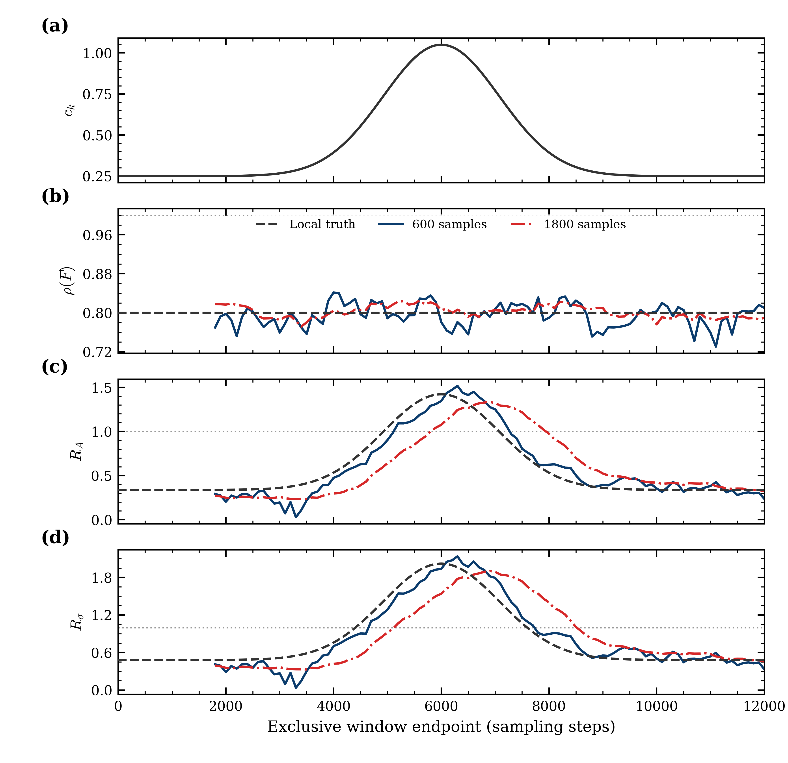
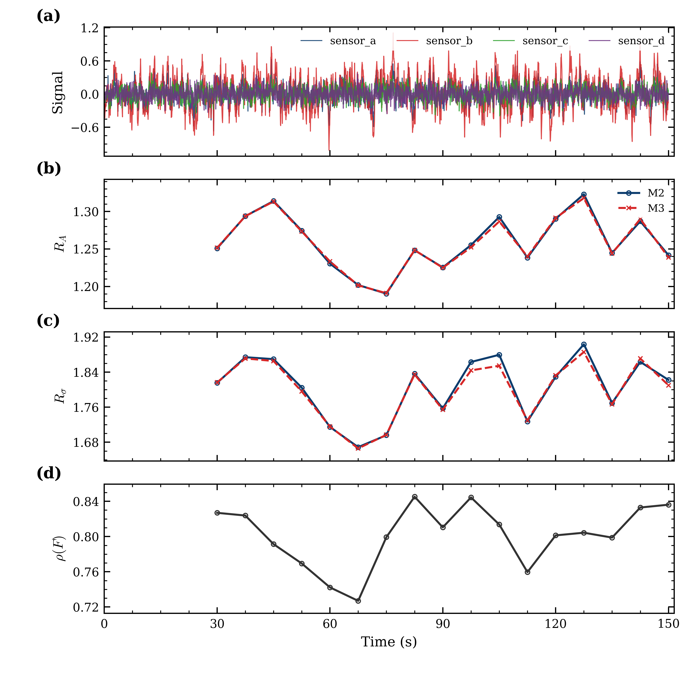
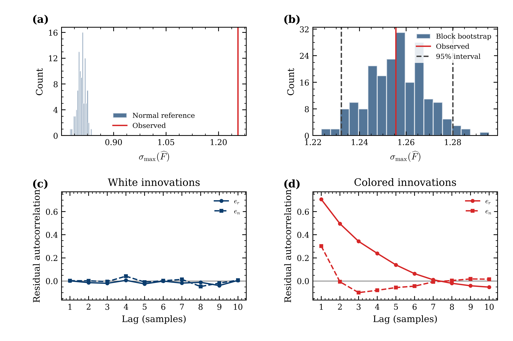

# Scientific examples

[Home](../README.md) · [Documentation](../docs/index.md) · [Manuscript resources](../manuscript/README.md)

Six illustrated tutorials, from known linear maps to data-driven inference and statistical checks. Each is self-contained and uses only synthetic observations or known model parameters; no external dataset is required. The figures are computed, not schematic. Install `.[dev]` from the redesigned checkout using the [quick start](../docs/quickstart.md).

| Example | What you will learn |
|---|---|
| [01 — Why non-normality matters](01_why_non_normality_matters/README.md) | Identical stable spectra, different finite-time responses. |
| [02 — Real and complex spectra](02_real_and_complex_spectra/README.md) | Spectral thresholds and sampling dependence. |
| [03 — Network inference](03_inference_from_network_data/README.md) | Recover a planted response plane and node-wise directions. |
| [04 — Time-varying dynamics](04_time_varying_dynamics/README.md) | Compare trailing-window lengths. |
| [05 — Analyze your own data](05_analyze_your_own_data/README.md) | Run a configurable multichannel CSV workflow. |
| [06 — Validation and uncertainty](06_validation_and_uncertainty/README.md) | Compare normal references, residual checks and bootstrap intervals. |

## Gallery

Click each image to view the full-size figures, code and interpretation.

| Fundamentals | Spectral families |
|---|---|
| [](01_why_non_normality_matters/README.md) | [](02_real_and_complex_spectra/README.md) |
| [01 — Why non-normality matters](01_why_non_normality_matters/README.md) | [02 — Real and complex spectra](02_real_and_complex_spectra/README.md) |
| **Network inference** | **Time-varying dynamics** |
| [](03_inference_from_network_data/README.md) | [](04_time_varying_dynamics/README.md) |
| [03 — Network inference](03_inference_from_network_data/README.md) | [04 — Time-varying dynamics](04_time_varying_dynamics/README.md) |
| **Experimental data workflow** | **Validation and uncertainty** |
| [](05_analyze_your_own_data/README.md) | [](06_validation_and_uncertainty/README.md) |
| [05 — Analyze your own data](05_analyze_your_own_data/README.md) | [06 — Validation and uncertainty](06_validation_and_uncertainty/README.md) |

## Run the examples

From the redesigned repository root, after activating your environment:

```bash
python examples/01_why_non_normality_matters/run.py --out results/example01
python examples/02_real_and_complex_spectra/run.py --out results/example02
python examples/03_inference_from_network_data/run.py --out results/example03
python examples/04_time_varying_dynamics/run.py --out results/example04
python examples/05_analyze_your_own_data/run.py --out results/example05
python examples/06_validation_and_uncertainty/run.py --out results/example06
```

Each script accepts `--help` and an output directory. Reference figures are supplied in PNG, PDF and SVG; numerical outputs are generated by the scripts. Use the individual tutorials to explore alternative parameters. The results describe the chosen seeded models, not general guarantees of recovery or statistical calibration.

The [end-to-end Python tutorial](../docs/tutorial.md) remains available for users who prefer a single script. See [figure conventions](FIGURE_STYLE.md) and the separate [manuscript reproduction resources](../manuscript/README.md).
