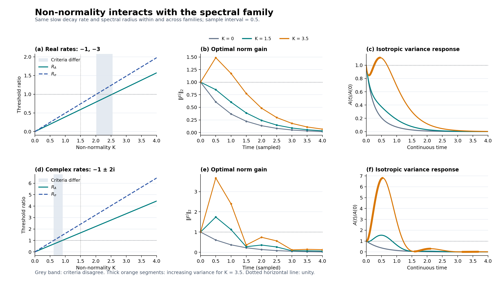

# Scientific examples

[Repository home](../README.md) · [Documentation](../docs/index.md) · [Manuscript reproducibility](../manuscript/README.md)

These examples teach NNDR through scientific questions. They are independent of the paper-specific data and can be run offline after installing the package and its `dev` extras.

| Example | Scientific question |
|---|---|
| [01 — Why non-normality matters](01_why_non_normality_matters/README.md) | Why can identical stable eigenvalues produce different finite-time responses? |
| [02 — Real and complex spectra](02_real_and_complex_spectra/README.md) | How do spectral family and sampling interval change amplification? |

For the existing end-to-end tutorial, see [the tutorial guide](../docs/tutorial.md) and [its runnable script](tutorial_nndr.py). Manuscript-specific validation and figures are maintained separately in [manuscript/](../manuscript/README.md).
