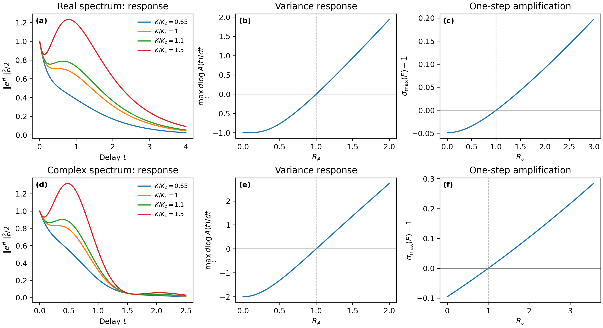
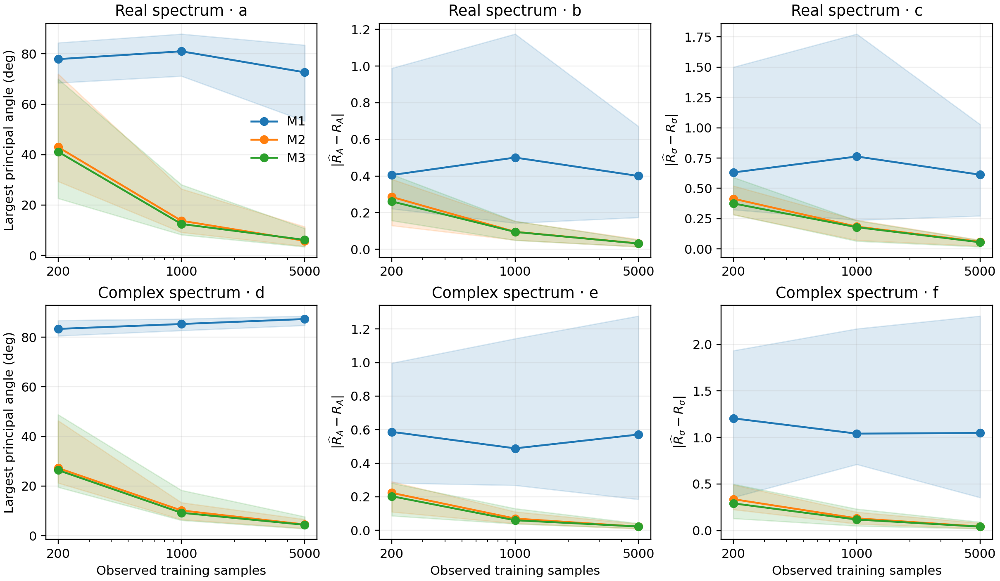

# Manuscript resources and reproducibility

Companion to *Inferring Non-Normal Amplification Geometry from Multivariate Time Series*, V. R. Saiprasad, V. Troude and D. Sornette (2026). The [original preprint](https://arxiv.org/abs/2607.14786) and the revised toolkit use different threshold conventions; see the [migration notes](../THRESHOLD_MIGRATION.md).

This toolkit retains two self-contained synthetic validation experiments. The representative empirical analyses and manuscript figure resources are in the [separate reproduction repository](https://github.com/Saiprasad-V-R/nndr-reproducibility).

## Software version

These instructions describe the reorganized checkout using the NNDR 2.0.0 scientific API. The published tag `2.0.0` retains its original directory layout. Follow the documentation within that snapshot if reproducing the fixed release. To obtain the current repository, clone it if needed:

```bash
git clone https://github.com/Saiprasad-V-R/nndr-toolkit.git
cd nndr-toolkit
```

The [historical implementation](https://github.com/Saiprasad-V-R/nndr-toolkit/tree/v1.0.0) is retained separately. For new analyses, use the revised release and record the software commit, preprocessing settings and random seeds.

## Environment

Run commands from the repository root in an activated Python environment (Python >= 3.9):

```bash
python -m pip install -e '.[dev]'
python -m pip check
```

For the independently validated macOS Apple Silicon environment (Python 3.9.6, NumPy 1.26.4, SciPy 1.13.1, Matplotlib 3.9.4 and MNE 1.8.0), use [requirements-validated-macos.txt](../requirements-validated-macos.txt) as a constraints file. That file records one environment, not a universal cross-platform lockfile. See the [package README](../README.md) and [scientific API](../docs/scientific_api.md) for analysis of new data.

## Common revised methodology

For data with shape `(N_channels, T_samples)`, form observed adjacent pairs `X = x[:, :-1]`, `Y = x[:, 1:]` within each window. Centering, scaling and filtering are dataset-specific and must be stated. Relative ridge estimation and trace-preserving shrinkage are

```text
nu = nu_rel * tr(X X^T) / N
Fhat = Y X^T (X X^T + nu I)^(-1)
Freg = (1-alpha) Fhat + alpha * tr(Fhat)/N * I
Gamma = Q^T Freg Q
```

M2 maximizes directed coupling between orthogonal directions; M3 extracts the commutator plane and orders its input and reaction directions. Compare both on the same fitted operator. M1 is an eigenbasis-SVD baseline. Shrinkage does not guarantee stability. Windows are displayed at their trailing endpoint unless explicitly specified otherwise; offline zero-phase filtering is not causal preprocessing.

For a stable real 2-by-2 reduced map `Gamma`, the revised diagnostics are:

- `R_A`: variance-response criterion, using the real principal logarithm `L = log(Gamma)/dt`. For real rates `-gamma1, -gamma2`, set `Delta_rate = abs(gamma1-gamma2)/(gamma1+gamma2)` and `s = sqrt(1-Delta_rate^2)`; `Kc_A = sqrt(s/(1-s))`. For a complex pair `-gamma +/- i omega`, set `beta = abs(omega)/gamma` and `Kc_A = 1/sqrt(sqrt(1+beta^2)-1)`. Away from degeneracy, `R_A = K/Kc_A`. The implementation uses a finite repeated-eigenvalue limit where applicable. `R_A > 1` indicates a delayed increasing interval in the isotropic impulse variance-response kernel, not necessarily a peak exceeding its initial value.
- `R_sigma = d_F(Gamma)/sqrt((1-|lambda1|^2)(1-|lambda2|^2))`, where `d_F` is the Henrici departure from normality. For a stable reduced map, `R_sigma > 1` is equivalent to `sigma_max(Gamma) > 1`.
- `K = d_F(Gamma)/|lambda1-lambda2|` for distinct multipliers. Stability and principal-log admissibility are reported separately; undefined ratios are NaN. No forced spectral stabilization or clipping is used by the revised threshold implementation.
- The default package `support` is `||r||_1/(sqrt(N)||r||_2)`. Figure 12 deliberately retains its archived entropy support and discrete multiplier splitting, defined below. These are distinct diagnostics, not interchangeable names.

Neither ratio is a clinical, behavioral or causal threshold. Norm-dependent quantities depend on measurement coordinates. Agreement between M2 and M3 checks extraction-rule sensitivity, not the validity of the fitted operator. See [estimation and adequacy](../docs/estimation_adequacy.md) and [statistical controls](../docs/statistical_controls.md) for assumptions and limitations.

## 1. Synthetic validation (fully runnable)

These are newly designed checks of the revised mathematical framework, not exact recreations of numbered figures from the original preprint.

### 1.1 Real and complex threshold validation

```bash
python -W error::RuntimeWarning manuscript/synthetic/validate_thresholds.py --out results/synthetic/thresholds
```

The experiment evaluates 420 sampled stable maps from 140 real/complex generators, with independently computed kernel derivatives and direct singular values. The validated macOS run reported zero classification disagreements for either criterion, and 42 `R_A` boundary cases. The derivative oracle uses a finite numerical search, not an analytical proof.



Outputs: `threshold_sweep.csv`, `summary.json`, `threshold_ground_truth.png` and `.svg`. See [experiment details](synthetic/README.md).

### 1.2 Finite-data recovery

```bash
python -W error::RuntimeWarning manuscript/synthetic/validate_recovery.py --out results/synthetic/recovery
```

A known two-dimensional block is embedded orthogonally in a stable 12-dimensional system. M1, M2 and M3 are compared on identical fitted operators at 200, 1000 and 5000 samples, for four target `R_A` values and twelve seeded realizations per spectral family and target. The default run produces 1,536 rows across truth, oracle, known-plane and inferred stages. Invalid estimates are retained in the raw results. At 5000 samples, M2/M3 achieved 100% `R_A` classification accuracy in this particular design, not a universal guarantee.



Outputs: `recovery_trials.csv`, `recovery_summary.csv`, `recovery_summary.json`, `recovery_benchmark.png` and `.svg`. See [experiment details](synthetic/README_recovery.md). The original benchmark's historical M3 support convention is documented there; it is not the current directed-support API. Included preview figures were generated in the original validation runs; use the commands above to regenerate them locally.

## Empirical manuscript resources

The uterine EHG, seizure EEG, freezing-of-gait and push-up calculations, archived data, figures and reproduction guides are in [nndr-reproducibility](https://github.com/Saiprasad-V-R/nndr-reproducibility). The two synthetic validations above remain in this toolkit.

## Scope of validation and citation

Use the [main README](../README.md) for citation and software license. Public data have their own licenses and recommended citations. The selected synthetic examples were independently executed in the validated environment. The project does not claim that every figure, cohort result or statistical calibration in the revised manuscript is reproduced by this release. Model adequacy, surrogate assumptions, sampling aliasing and preprocessing must be assessed for each new application.
