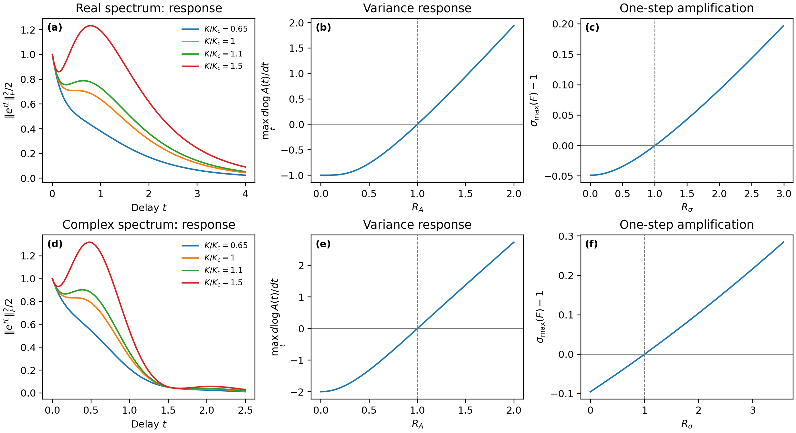
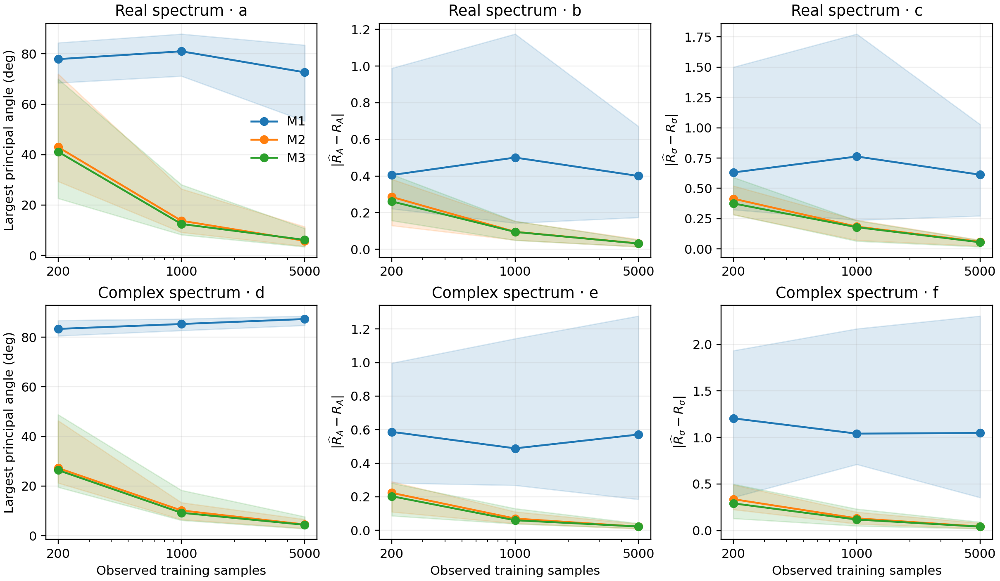

# Reproducibility of NNDR

Companion to *Inferring Non-Normal Amplification Geometry from Multivariate Time Series*, V. R. Saiprasad, V. Troude and D. Sornette (2026). The [original preprint](https://arxiv.org/abs/2607.14786) and the revised toolkit use different threshold conventions; see the [migration notes](../THRESHOLD_MIGRATION.md).

This repository is a reusable Python analysis package, with two self-contained synthetic validation experiments and one representative seizure EEG reproduction. The remaining empirical applications are documented below as methodological references, not as complete, independently reproduced revised pipelines. The original push-up recording is included. Large public datasets are not bundled.

## Software version

These instructions accompany NNDR 2.0.0. For a fixed release snapshot:

```bash
git clone https://github.com/Saiprasad-V-R/nndr-toolkit.git
cd nndr-toolkit
git switch --detach 2.0.0
```

The [historical implementation](https://github.com/Saiprasad-V-R/nndr-toolkit/tree/v1.0.0) is retained separately. For new analyses, use the revised release and record the software commit, preprocessing settings and random seeds.

## Environment

Run commands from the repository root in an activated Python environment (Python >= 3.9):

```bash
python -m pip install -e '.[dev]'
python -m pip install -r reproducibility/seizure/requirements.txt
python -m pip check
```

The EEG dependency is optional if running synthetic experiments only. For the independently validated macOS Apple Silicon environment (Python 3.9.6, NumPy 1.26.4, SciPy 1.13.1, Matplotlib 3.9.4 and MNE 1.8.0), use [requirements-validated-macos.txt](../requirements-validated-macos.txt) as a constraints file. That file records one environment, not a universal cross-platform lockfile. See the [package README](../README.md) and [scientific API](../docs/scientific_api.md) for analysis of new data.

## Common revised methodology

For data with shape `(N_channels, T_samples)`, form observed adjacent pairs `X = x[:, :-1]`, `Y = x[:, 1:]` within each window. Centering, scaling and filtering are dataset-specific and must be stated. Relative ridge estimation and trace-preserving shrinkage are

```text
nu = nu_rel * tr(X X^T) / N
Fhat = Y X^T (X X^T + nu I)^(-1)
Freg = (1-alpha) Fhat + alpha * tr(Fhat)/N * I
Gamma = Q^T Freg Q
```

M2 maximizes directed coupling between orthogonal directions; M3 extracts the commutator plane and orders its input and reaction directions. Compare both on the same fitted operator. M1 is an eigenbasis-SVD baseline. Shrinkage does not guarantee stability. Windows are displayed at their trailing endpoint unless explicitly specified otherwise; offline zero-phase filtering is not causal preprocessing.

For a stable real 2-by-2 reduced map `Gamma`, the revised diagnostics are:

- `R_A`: variance-response criterion, using the real principal logarithm `L = log(Gamma)/dt`. For real rates `-gamma1, -gamma2`, set `Delta_rate = abs(gamma1-gamma2)/(gamma1+gamma2)` and `s = sqrt(1-Delta_rate^2)`; `Kc_A = sqrt(s/(1-s))`. For a complex pair `-gamma +/- i omega`, set `beta = abs(omega)/gamma` and `Kc_A = 1/sqrt(sqrt(1+beta^2)-1)`. Away from degeneracy, `R_A = K/Kc_A`. The implementation uses a finite repeated-eigenvalue limit where applicable. `R_A > 1` indicates a delayed increasing interval in the isotropic impulse variance-response kernel, not necessarily a peak exceeding its initial value.
- `R_sigma = d_F(Gamma)/sqrt((1-|lambda1|^2)(1-|lambda2|^2))`, where `d_F` is the Henrici departure from normality. For a stable reduced map, `R_sigma > 1` is equivalent to `sigma_max(Gamma) > 1`.
- `K = d_F(Gamma)/|lambda1-lambda2|` for distinct multipliers. Stability and principal-log admissibility are reported separately; undefined ratios are NaN. No forced spectral stabilization or clipping is used by the revised threshold implementation.
- The default package `support` is `||r||_1/(sqrt(N)||r||_2)`. Figure 12 deliberately retains its archived entropy support and discrete multiplier splitting, defined below. These are distinct diagnostics, not interchangeable names.

Neither ratio is a clinical, behavioral or causal threshold. Norm-dependent quantities depend on measurement coordinates. Agreement between M2 and M3 checks extraction-rule sensitivity, not the validity of the fitted operator. See [estimation and adequacy](../docs/estimation_adequacy.md) and [statistical controls](../docs/statistical_controls.md) for assumptions and limitations.

## 1. Synthetic validation (fully runnable)

These are newly designed checks of the revised mathematical framework, not exact recreations of numbered figures from the original preprint.

### 1.1 Real and complex threshold validation

```bash
python -W error::RuntimeWarning reproducibility/synthetic/validate_thresholds.py --out results/synthetic/thresholds
```

The experiment evaluates 420 sampled stable maps from 140 real/complex generators, with independently computed kernel derivatives and direct singular values. The validated macOS run reported zero classification disagreements for either criterion, and 42 `R_A` boundary cases. The derivative oracle uses a finite numerical search, not an analytical proof.



Outputs: `threshold_sweep.csv`, `summary.json`, `threshold_ground_truth.png` and `.svg`. See [experiment details](synthetic/README.md).

### 1.2 Finite-data recovery

```bash
python -W error::RuntimeWarning reproducibility/synthetic/validate_recovery.py --out results/synthetic/recovery
```

A known two-dimensional block is embedded orthogonally in a stable 12-dimensional system. M1, M2 and M3 are compared on identical fitted operators at 200, 1000 and 5000 samples, for four target `R_A` values and twelve seeded realizations per spectral family and target. The default run produces 1,536 rows across truth, oracle, known-plane and inferred stages. Invalid estimates are retained in the raw results. At 5000 samples, M2/M3 achieved 100% `R_A` classification accuracy in this particular design, not a universal guarantee.



Outputs: `recovery_trials.csv`, `recovery_summary.csv`, `recovery_summary.json`, `recovery_benchmark.png` and `.svg`. See [experiment details](synthetic/README_recovery.md). The original benchmark's historical M3 support convention is documented there; it is not the current directed-support API. Included preview figures were generated in the original validation runs; use the commands above to regenerate them locally.

## 2. Representative seizure EEG (fully runnable)

**Data:** [CHB-MIT Scalp EEG Database, PhysioNet](https://physionet.org/content/chbmit/1.0.0/), recording `chb01/chb01_03.edf`, onset 2996 s and termination 3036 s. See [data attribution and license](seizure/DATA_LICENSE.md). The EDF is downloaded separately; the repository includes the derived plotting CSVs, original plotting scripts and reference PDFs.

**Reproduce the approved main and supplementary Figure 12 from archived CSVs:**

```bash
python reproducibility/seizure/representative/scripts/plot_figure12_RA_main.py
python reproducibility/seizure/representative/scripts/plot_figure12_chb01_03_Rsigma_supp.py
```

**Recompute from the original EDF and audit numerical parity:**

```bash
python reproducibility/seizure/download_data.py --data-dir results/seizure/data
python -W error::RuntimeWarning reproducibility/seizure/representative/evaluate_edf.py \
  --edf results/seizure/data/chb01_03.edf --out results/seizure/audit
```

The validated configuration uses a fixed core16 bipolar montage, 60 Hz notch (Q=30), fifth-order zero-phase Butterworth bandpass 0.5–15 Hz, anti-aliased polyphase resampling from 256 to 32 Hz, within-window centering, relative ridge 0.003 and shrinkage 0.05. Windows are 40 s long with 2 s step; 201 endpoints span -160 to +240 s relative to onset. M2 uses 12 restarts, 200 iterations and seed 0; M3 uses directed ordering. Only one window is entirely ictal. The figure-specific support is `exp(-sum(p_i log p_i))/N`, with `p_i = r_i^2/sum(r_j^2)`; splitting is `|lambda1-lambda2|/|lambda1+lambda2|`. Both figures retain the original four-panel style, raw traces and five-endpoint median overlays within valid segments. Original fixed plotting limits are retained; extreme values remain in the CSV.

The Mac audit passed all nine numerical comparisons with no finite-mask mismatches, and waveform maximum absolute error 1.28e-11 microvolts. Valid ratio counts were 190/201 for M2 and 201/201 for M3. The largest absolute ratio error was 1.62e-6. See the [parity report](seizure/representative/validation/parity_report.json), [representative README](seizure/representative/README.md), and [main](seizure/representative/reference_figures/figure12_chb01_03_RA_main.pdf) / [supplementary](seizure/representative/reference_figures/figure12_chb01_03_Rsigma_supp.pdf) reference figures. The evaluator reconstructs the original analysis within specified numerical tolerances; it is not the unavailable byte-identical original evaluation script. This is a descriptive single-event analysis, not a seizure-prediction validation. Cohort-level reproduction is outside this public example.

## 3. Uterine EHG and freezing of gait (methodological reference)

The following settings describe the original manuscript workflows recorded in the former root reproducibility guide. They do not assert exact parity with the revised cohort analyses.

- **EHG:** [Icelandic 16-electrode Electrohysterogram Database](https://physionet.org/content/ehgdb/1.0.0/), WFDB physical signals and contraction annotations. Original representative recording `ice012_p_1of4`, EHG9–EHG12; original cohort 123 recordings/45 subjects. Read calibrated signals with `physical=True`, convert mV to microvolts (do not multiply by the raw MAT conversion factor), filter 0.08–2 Hz, resample to 10 Hz. Original windows 60 s, step 5 s, shrinkage 0.1. Activity reference is the channel-mean Hilbert magnitude. Original high-activity and baseline groups use the upper 20% and lower 50% of that envelope per recording, with recording-level Spearman correlation and Cliff's delta, then subject medians. These activity definitions are not direct mechanical contraction measurements.
- **FOG:** [Daphnet Freezing of Gait](https://archive.ics.uci.edu/dataset/245/daphnet+freezing+of+gait), three ankle acceleration axes. Original representative event `S01R01`, event 03, 1236.0–1245.6 s; first 4 s of freezing used as onset interval. Original windows 3 s, step 0.5 s; compare onset with matched non-freezing baseline and distinguish sustained freezing and gait re-initiation. The revised supplementary analyses are not bundled.

For new analyses use the revised NNDR API, specifying preprocessing, sampling interval, ridge and admissibility rules. Original cohort counts or methods above are historical descriptors, not newly verified revised results.

## 4. Rhythmic push-up recording (data and methodology)

The included [Apple Watch data](../data/pushup/) (`raw_samples_Pushup_duo_27Dec2025..csv`) contain timestamp and `accX`, `accY`, `accZ` user acceleration in g, with gravity already removed. The final revised push-up workflow is described here using the authors' `README_pushup.md` and `fig15_pushup_revised_final.py`; the standalone script is not distributed in this selected reproduction folder.

- Primary signal: demeaned raw acceleration, without per-axis standardization or forced stability rescaling. Classify adjacent pairs by the activity at their predictor time, using a causal trailing 0.5 s mean of acceleration magnitude and the upper 15% as high activity.
- Fit separate low/high operators with relative ridge 0.003, shrinkage 0.04, and M2/M3. Report full and reduced spectral radii, singular values and both corrected ratios.
- Offline sensitivity: phase-adaptive three-harmonic removal of voluntary movement, residual bands 1–15 Hz and 1–24 Hz.
- Class-conditioned uncertainty: 2000 circular moving-block bootstrap replicates with 5 s blocks, preserving original pairs and labels without constructing cross-block transitions. Stationary VAR residual-vector and common-phase Fourier nulls; circular-shift timing is secondary.
- Separate registered moving-window test: raw demeaned acceleration, M3, 1 s window, 0.1 s step; measure the fraction satisfying `rho(Gamma) < 1 < sigma_max(Gamma)`. Compare with 500 time-varying spectrum- and total-variance-matched normal null realizations and 2000 circular 5 s bootstrap replicates. Use a one-sided Monte Carlo rank p-value.

Reference data checks from the final push-up README: 2252 samples, approximately 50.0854 Hz, 1913 low and 338 high pairs. This is a single-participant illustration. The push-up script and complete revised outputs were not independently rerun as part of this repository update; full reproduction is available only with the authors' final analysis source. Do not confuse the class-conditioned ratios with the separate moving-window statistic.

## Scope of validation and citation

Use the [main README](../README.md) for citation and software license. Public data have their own licenses and recommended citations. The selected synthetic and representative EEG examples were independently executed in the validated environment. The project does not claim that every figure, cohort result or statistical calibration in the revised manuscript is reproduced by this release. Model adequacy, surrogate assumptions, sampling aliasing and preprocessing must be assessed for each new application.
